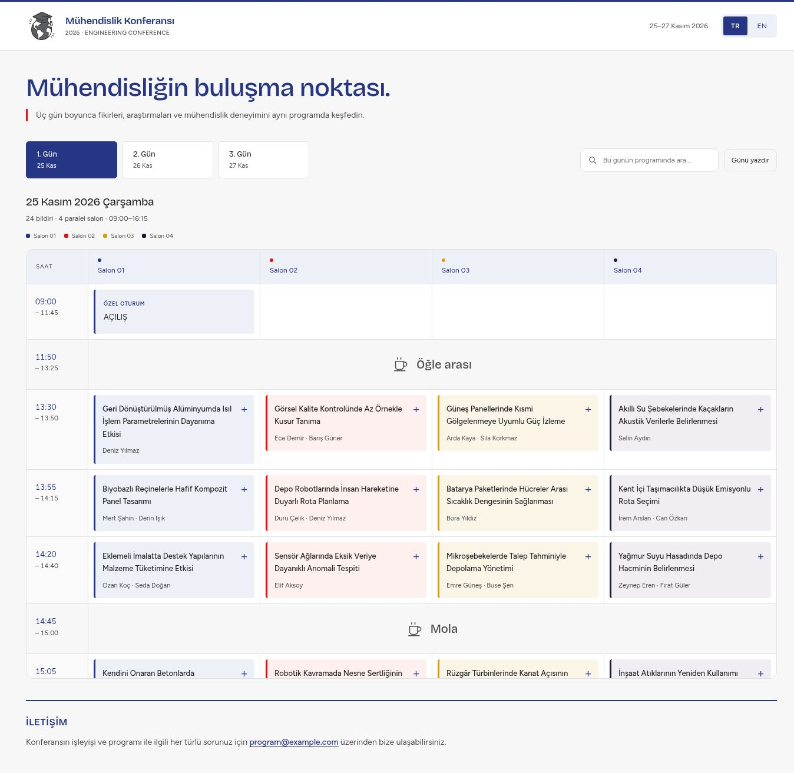
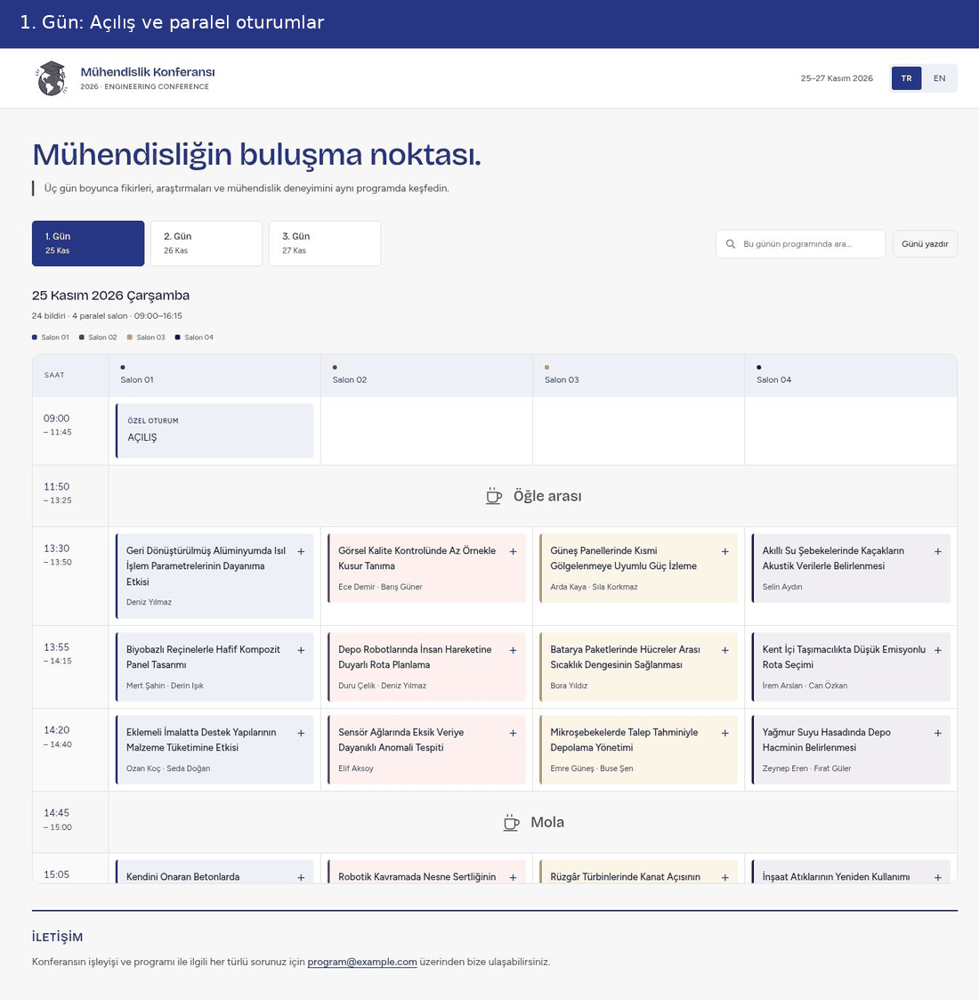

# Engineering Conference Program

Üç günlük mühendislik konferansları için Türkçe ve İngilizce kullanılabilen, mobil uyumlu bir program arayüzü. Dört paralel salonun oturumları aynı tabloda görüntülenir; bildiri başlıklarına tıklanarak özetler açılır.

Uygulama tek bir `index.html` dosyasıyla çalışır. Kurulum, paket yöneticisi, veritabanı veya sunucu uygulaması gerektirmez.

## Önizleme



## Kullanım demosu

Animasyon; 1., 2. ve 3. gün arasında geçişi, bildiri özetinin açılıp kapanmasını ve İngilizce görünümü gösterir.



README üzerindeki GIF bir tanıtım kaydıdır. Kontrolleri kendiniz kullanmak için `index.html` dosyasını tarayıcıda açın veya uygulamayı GitHub Pages ile yayımlayın.

## Özellikler

- Türkçe varsayılan görünüm ve TR / EN dil seçimi.
- Üç gün arasında geçiş, dört paralel salon ve 108 örnek bildiri.
- Başlığın altında açılan Türkçe ve İngilizce özetler.
- Bildiri kutularında yazar adları; birden fazla yazar arasında `·` ayırıcı.
- Günün programında başlık ve yazar araması.
- Seçili günü yazdırma veya tarayıcının yazdırma ekranından PDF olarak kaydetme.
- Küçük ekranlarda yatay kaydırılabilen program tablosu.
- JavaScript çalışmasa da kullanılabilen gün/dil seçimi, tablolar ve özet açılışları.
- İnternet bağlantısı gerektirmeyen gömülü yazı tipleri ve logo.

## Bilgisayarda çalıştırma

1. Repoyu indirin veya klonlayın.
2. `index.html` dosyasını Chrome, Edge, Firefox veya Safari gibi bir tarayıcıyla açın.
3. İstediğiniz günü ve dili seçin. Özetini okumak için bir bildiri başlığına tıklayın.

Arama ve yazdırma JavaScript ile geliştirilmiş özelliklerdir. Dosya önizleme uygulamalarının sunduğu etkileşimler, tam tarayıcı kullanımından farklı olabilir. Fiziksel iPhone cihazında doğrulama yapılmamıştır.

## GitHub Pages ile yayımlama

1. Repo köküne `index.html`, `README.md`, `assets` ve `tools` klasörlerini yükleyin.
2. Repo içinde **Settings → Pages** bölümünü açın.
3. **Source** alanında **Deploy from a branch** seçin.
4. Dal olarak **main**, klasör olarak **/ (root)** seçip **Save** düğmesine basın.
5. Yayın tamamlandığında Pages ekranında verilen adresi paylaşın.

README görselleri `assets` klasörüne göreli yollarla bağlanır. Bu klasörü README ile birlikte yükleyin. ZIP dosyasını tek başına repoya yüklemek yerine içeriğini çıkarıp dosyaları yükleyin.

Resmî yönerge: [GitHub Pages yayın kaynağını yapılandırma](https://docs.github.com/en/pages/getting-started-with-github-pages/configuring-a-publishing-source-for-your-github-pages-site).

## Bildirileri düzenleme

VS Code’da `index.html` dosyasını açıp **BİLDİRİLERİ BURADAN DÜZENLEYİN** ifadesini arayın. `program-data` bölümündeki her bildiri ayrı bir kayıttır:

```json
{
  "id": "d1-B11",
  "tr": "Türkçe bildiri başlığı",
  "en": "English paper title",
  "authors": [
    "Ayşe Yılmaz",
    "Mehmet Demir"
  ],
  "abstract": {
    "tr": "Türkçe özet metni.",
    "en": "English abstract text."
  }
}
```

Bu örnek ilgili alanları gösterir; mevcut kaydı düzenlerken diğer alanları ve JSON yapısını koruyun. Metin içindeki çift tırnakları `\"` olarak yazın. Her özet en fazla 200 kelime olmalıdır.

Normal tarayıcı kullanımında program verileri açılışta yeniden işlenir. JavaScript çalıştırmayan görüntüleyiciler için dosyanın içinde ayrıca hazır tablolar bulunur. Veri değişikliklerinden sonra bu tabloları da güncellemek için repo klasöründe çalıştırın:

```bash
python tools/sync_program.py
```

Windows’ta Python başlatıcısı kullanılıyorsa:

```powershell
py tools/sync_program.py
```

Yalnızca kontrol yapmak için:

```bash
python tools/sync_program.py --check
```

Yardımcı betik Python 3.9 veya üzerini ve yalnızca standart kütüphaneyi kullanır. Uygulamayı görüntülemek için Python gerekmez. Betik; JSON yapısını, özet uzunluklarını ve aynı gün saat aralıkları çakışan farklı salonlardaki ortak yazarları denetler. Bir çakışma bulursa yazarları otomatik değiştirmek yerine hatayı bildirir.

## Dosyalar

| Dosya | Amaç |
| --- | --- |
| `index.html` | Uygulama, program verileri, stiller, etkileşimler, gömülü fontlar ve logo |
| `README.md` | Tanıtım, kurulum ve düzenleme açıklamaları |
| `assets/overview.jpg` | Genel ekran görüntüsü |
| `assets/demo.gif` | Gün/dil değişimi ve özet açılışlarının animasyonu |
| `tools/sync_program.py` | Veri kontrolü ve JavaScript’siz tabloların güncellenmesi |
| `description.txt` | GitHub repo açıklaması için kopyalanabilir metin |

## Teknoloji ve örnek içerik

HTML, CSS ve JavaScript kullanılmıştır. Başlıklarda Bricolage Grotesque, metinlerde Figtree kullanılır; font lisans metinleri HTML içinde bulunur.

Bildiri başlıkları, yazar isimleri ve özetler arayüzü göstermek için oluşturulmuş örnek içeriklerdir. Gerçek bir konferans programını veya tamamlanmış araştırma sonuçlarını temsil etmez. İletişim adresi `program@example.com` örnek adresidir.
